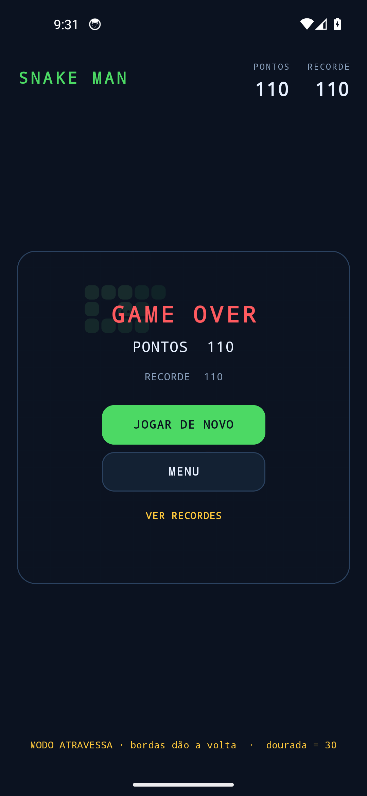
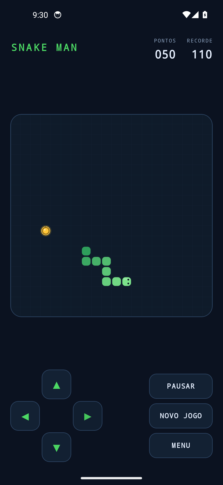
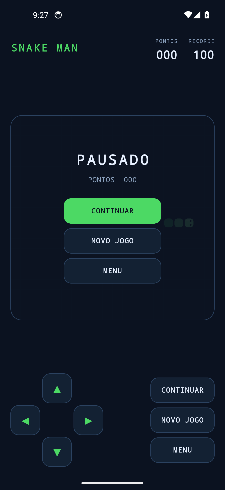
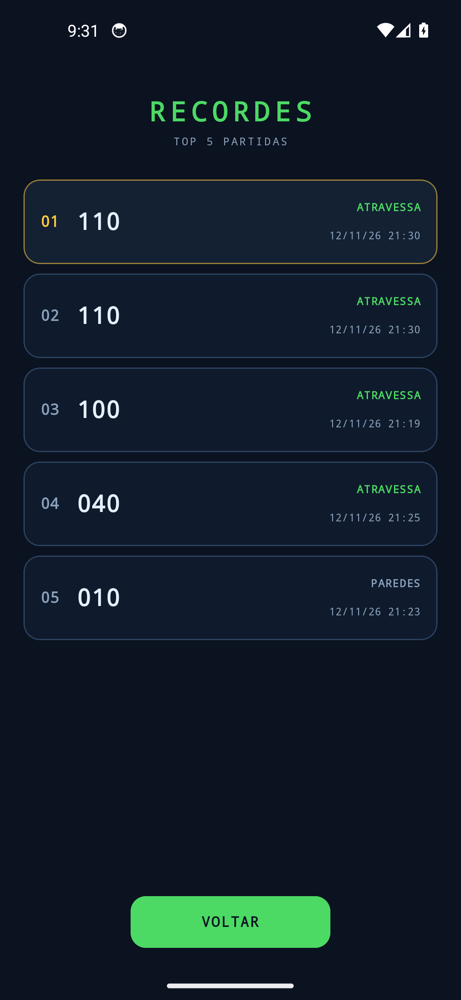
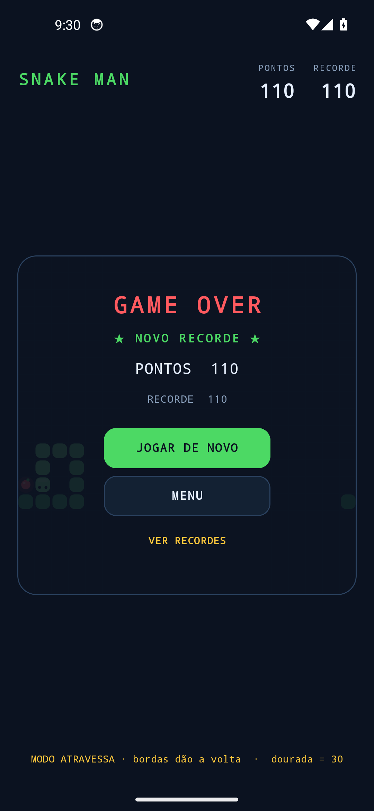

# 🐍 Snake Man


**[⬇️ Baixar o APK mais recente](https://github.com/Mati-Pereira/snake-man/releases/latest)** · Android 7.0+ · 6,3 MB

Jogo da cobra (Snake) para Android, escrito em **Kotlin + Jetpack Compose**.
Interface arcade escura, controle por swipe ou D-pad, maçã dourada com tempo,
placar top 5, sons sintetizados e dois modos de borda.

O projeto foi pensado para ser simples de ler: **toda a lógica do jogo é Kotlin puro**
(sem imports de Android), então ela roda em testes de JVM na velocidade de milissegundos,
e a UI é só uma projeção do estado do motor.

---

## 📸 Screenshots

| | |
|---|---|
|  |  |
| Menu: modo, jogar e recordes | Jogando: maçã dourada com anel de tempo |
|  |  |
| Pausa | Placar top 5 |
|  | |
| Game over com novo recorde | |

Capturados no emulador Android 14 (Pixel 5, 1080×2340), build de release.

---

## 🎮 Como jogar

| Ação | Comando |
|---|---|
| Virar | **Swipe** em qualquer direção sobre o tabuleiro **ou** os botões do **D-pad** |
| Pausar / continuar | Botão **PAUSAR** (ou sair do app — ele pausa sozinho) |
| Novo jogo | **NOVO JOGO** durante a partida, ou **JOGAR DE NOVO** no game over |
| Ver placar | **RECORDES** no menu, ou **VER RECORDES** no game over |

### Pontuação

| Item | Pontos | Observação |
|---|---|---|
| Maçã comum (vermelha) | **10** | cresce 1 segmento |
| Maçã dourada | **30** | cresce 1 segmento, expira em 45 passos |
| Bater na parede (modo PAREDES) | — | fim de jogo |
| Bater no próprio corpo | — | fim de jogo |
| Preencher o tabuleiro | — | "TABULEIRO CHEIO!" |

### Modos de borda

- **PAREDES** — encostar na borda encerra a partida.
- **ATRAVESSA** — a cobra sai de um lado e aparece no outro (wrap), inclusive na vertical.

### Velocidade

Começa em **190 ms por passo** e acelera **6 ms** a cada maçã comida, com piso de
**70 ms**. Em outras palavras: o jogo fica progressivamente mais difícil até estabilizar.

---

## ✨ Funcionalidades

- **Grid 20×20** com maçã sempre em célula livre
- **Swipe** com limiar de 24 dp e **D-pad** na tela
- Fila de direções (até 2) que **bloqueia viradas de 180°** e evita auto-colisão acidental
- **Maçã dourada**: uma a cada 5 maçãs, vale 30 pontos e mostra o tempo restante
  num anel que se esvazia
- **Velocidade progressiva** com curva suave
- **Recorde persistente** (SharedPreferences) + selo "★ NOVO RECORDE ★"
- **Placar top 5** com pontos, modo e data de cada partida, em tela própria
- **Pausa manual e automática** (ao mandar o app para segundo plano)
- **Sons sintetizados** sem nenhum asset de áudio:
  - maçã comum: bip curto
  - dourada: arpejo ascendente de 3 notas
  - game over: 3 notas descendentes
  - novo recorde: fanfarra
- **Vibração** curta ao comer e ao morrer
- **Tela sempre ligada** durante a partida
- **Tema escuro** fixo, tipografia monoespaçada estilo arcade
- **Ícone adaptativo** (com camada monocromática para Android 13+)
- **Edge-to-edge** com barras do sistema em modo escuro

---

## 🧱 Stack

| Camada | Escolha |
|---|---|
| Linguagem | Kotlin 2.0.21 |
| UI | Jetpack Compose (BOM 2024.10.01) + Material 3 |
| Build | Gradle 8.11.1 (wrapper) + AGP 8.7.3 |
| SDK | compileSdk/targetSdk **35**, minSdk **24** (Android 7.0) |
| Testes | JUnit 4 na JVM (sem Robolectric) |
| Persistência | SharedPreferences |
| Áudio | `ToneGenerator` (sons gerados em runtime) |
| Gráficos | `Canvas` do Compose (nada de imagens) |

Nenhuma dependência além de AndroidX/Compose — sem libs de terceiros, sem assets
binários, sem serviços externos.

---

## 🏗 Arquitetura

```
┌─────────────────────────────────────────────────────────────┐
│  ui/ (Compose)                                              │
│  GameScreen.kt ─ estado, overlays, loop de ticks, placar    │
│  Board.kt ────── Canvas: grid, maçãs, cobra, olhos          │
│  Controls.kt ─── D-pad + gestos de swipe                    │
│  theme/ ──────── paleta e MaterialTheme                     │
└───────────────▲─────────────────────────────┬───────────────┘
                │ snapshot()                  │ tick() / queueDirection()
┌───────────────┴─────────────────────────────▼───────────────┐
│  game/ (Kotlin puro, zero Android)                          │
│  SnakeEngine.kt ─ movimento, colisão, wrap, maçã dourada,   │
│                   crescimento, velocidade                   │
│  GameModels.kt ── Direction, Cell, Apple, GameSnapshot      │
└───────────────▲─────────────────────────────┬───────────────┘
                │                             │
┌───────────────┴──────────┐   ┌──────────────▼──────────────┐
│  data/                    │   │  audio/                     │
│  Prefs.kt (SharedPrefs)   │   │  Feedback.kt (ToneGenerator │
│  ScoreEntry.kt (top 5)    │   │  + Vibrator)                │
└───────────────────────────┘   └─────────────────────────────┘
```

**Fluxo de um tick**

1. `LaunchedEffect(snapshot.status)` roda um loop `while (true) { delay(tickMillis); engine.tick() }`
   enquanto o status for `PLAYING`.
2. O motor aplica a direção enfileirada, calcula a nova cabeça, resolve borda
   (`SOLID` ou `WRAP`), checa colisão (a cauda que sai no mesmo tick não conta),
   come ou anda, envelhece a maçã dourada e ajusta a velocidade.
3. A UI recebe um `GameSnapshot` imutável e redesenha só o necessário.
4. O som/vibração é disparado no ponto de contato (comeu / morreu).

**Por que snapshot imutável?** O Compose compara referências; sem mutação escondida,
não existe estado "meio atualizado" na tela. E o motor continua testável sem Compose.

**Por que sem ViewModel?** O estado é local à tela e cabe em `remember`. Um ViewModel
não traria benefício aqui (não há navegação nem dados assíncronos além do loop).
A Activity declara `configChanges` para não recriar em rotação/eing/variação de layout
e o jogo segue em portrait.

---

## 📂 Estrutura do projeto

```
snakeman/
├── app/
│   ├── build.gradle.kts            # módulo, dependências, assinatura
│   └── src/
│       ├── main/
│       │   ├── AndroidManifest.xml # VIBRATE, portrait, launcher
│       │   ├── java/dev/matheus/snakeman/
│       │   │   ├── MainActivity.kt # setContent + edge-to-edge escuro
│       │   │   ├── game/
│       │   │   │   ├── GameModels.kt # Direction, Cell, Apple, snapshot
│       │   │   │   └── SnakeEngine.kt # regras do jogo
│       │   │   ├── data/
│       │   │   │   ├── Prefs.kt      # recorde, modo, placar
│       │   │   │   └── ScoreEntry.kt # top 5 (puro, testável)
│       │   │   ├── audio/Feedback.kt # sequências de som e vibração
│       │   │   └── ui/
│       │   │       ├── GameScreen.kt # telas, overlays, loop
│       │   │       ├── Board.kt      # desenho no Canvas
│       │   │       ├── Controls.kt   # D-pad e swipe
│       │   │       └── theme/Theme.kt
│       │   └── res/                  # temas, cores, ícones vetoriais
│       └── test/java/dev/matheus/snakeman/
│           ├── game/SnakeEngineTest.kt  # 17 testes
│           └── data/ScoreBoardTest.kt   # 6 testes
├── gradle/wrapper/                  # Gradle 8.11.1
├── screenshots/                     # capturas usadas neste README
├── keystore/                        # 🔒 NÃO versionado (assinatura)
├── dist/                            # 📦 APK final (não versionado)
├── AGENTS.md                        # guia para agentes de IA
└── README.md
```

---

## 🚀 Build

### Requisitos

- JDK **17+** (testado com Temurin 21)
- Android SDK com `platforms;android-35` e `build-tools;35.0.0`

### Configuração

`local.properties` (não versionado) aponta para o SDK:

```properties
sdk.dir=$HOME/Android/sdk
```

Variáveis de ambiente usadas neste ambiente:

```bash
export JAVA_HOME=$HOME/Android/jdk
export ANDROID_HOME=$HOME/Android/sdk
export PATH=$JAVA_HOME/bin:$PATH
```

### Comandos

```bash
./gradlew testDebugUnitTest   # 23 testes unitários (JVM)
./gradlew lintDebug           # Android Lint (0 erros)
./gradlew assembleDebug       # APK de debug
./gradlew assembleRelease     # APK de release assinado
```

Saídas:

```
app/build/outputs/apk/debug/app-debug.apk
app/build/outputs/apk/release/app-release.apk
```

---

## ✅ Testes

Os testes rodam na JVM porque `game/` e `ScoreEntry` não tocam em APIs do Android.

```bash
./gradlew testDebugUnitTest
# -> app/build/reports/tests/testDebugUnitTest/index.html
```

**SnakeEngineTest (17)** — início de partida, movimento, crescimento, colisão com parede
e com o corpo, wrap nos dois eixos, cauda que libera a célula, fila de direções,
bloqueio de 180°, curva de velocidade, pausa/retomada, reset, maçã dourada
(spawn na 5ª, +30 pontos, expiração) e maçã comum que não expira.

**ScoreBoardTest (6)** — top 5, desempate por data, round-trip de encode/decode,
robustez contra dados corrompidos e cálculo do recorde.

O motor expõe `loadForTest(...)` (internal) para montar cenários determinísticos
sem depender de aleatoriedade.

---

## 📦 APK

Build de release pronto para instalar — ou baixe direto da
[última release](https://github.com/Mati-Pereira/snake-man/releases/latest):

```
dist/SnakeMan-1.1-release.apk
```

```bash
adb install -r dist/SnakeMan-1.1-release.apk
```

(Se você vem da versão de debug, desinstale antes — a chave de assinatura é diferente:
`adb uninstall dev.matheus.snakeman`.)

---

## 🔐 Release assinada

O build de release lê `keystore/keystore.properties`:

```properties
storeFile=keystore/snakeman-release.jks
storePassword=********
keyAlias=snakeman
keyPassword=********
```

- **Nada disso é versionado** (`keystore/`, `*.jks` e `*.properties` estão no `.gitignore`).
- Se o arquivo não existir (clone novo, CI), o build **cai para a chave de debug**
  em vez de falhar — assim qualquer pessoa consegue compilar.
- Assinatura: **APK Signature Scheme v2 + v3**; keystore RSA 4096, validade ~27 anos.

Conferir a assinatura:

```bash
$ANDROID_HOME/build-tools/35.0.0/apksigner verify --verbose --print-certs \
    app/build/outputs/apk/release/app-release.apk
```

### Publicar uma atualização

1. Suba `versionCode` e `versionName` em `app/build.gradle.kts`.
2. `./gradlew assembleRelease`.
3. Publique o novo APK mantendo a **mesma keystore**.

> ⚠️ **Faça backup de `keystore/snakeman-release.jks` + senhas.** Sem ela não é
> possível atualizar o app em aparelhos que já o têm instalado.

---

## 📱 Emulador (opcional)

```bash
export ANDROID_AVD_HOME=$HOME/.config/.android/avd
$ANDROID_HOME/emulator/emulator -avd snake_pixel -gpu swiftshader_indirect -no-audio
```

Notas do ambiente onde o projeto foi desenvolvido:

- A AVD `snake_pixel` usa **Android 14 (google_apis, x86_64)**.
- A imagem **ATD (`aosp_atd`) apresentou composição quebrada** neste emulador:
  o app desenhava (`mDrawState=HAS_DRAWN`) mas o framebuffer ficava preto.
  Com a imagem `google_apis` tudo funcionou.
- As AVDs ficam em `~/.config/.android/avd` (XDG) — por isso `ANDROID_AVD_HOME`.
- Em alguns boots o app instalado não persiste; reinstale com `adb install -r`.

---

## 🧠 Decisões de projeto

| Decisão | Motivo |
|---|---|
| Motor em Kotlin puro | testes rápidos, determinísticos e sem emulador |
| Snapshot imutável | integração previsível com Compose, sem estado parcial |
| Canvas em vez de widgets | 400 células redesenhando a 5–14 Hz sem custo de layout |
| `ToneGenerator` | sons sem assets, APK pequeno, zero licenciamento |
| SharedPreferences | dados minúsculos (recorde + 5 linhas) e síncronos, sem schema |
| `configChanges` na Activity | evita recriar o jogo em mudanças de configuração |
| Fila de 2 direções | absorve swipes rápidos sem virar 180° por engano |
| Maçã dourada expirável | cria decisão de risco/recompensa sem novas telas |

---

## ⚠️ Limitações

- Portrait fixo (jogo pensado para uma mão e tabuleiro quadrado).
- Sem suporte a gamepad/teclado (fácil de adicionar em `Controls.kt`).
- Placar local apenas — não há sync/nuvem.
- Sem localização: textos em português embutidos no código de UI.
- Sem CI configurado.

## 💡 Ideias para o futuro

- Combo de maçãs (pontuação em sequência)
- Obstáculos fixos por nível
- Modo "desafio diário" com seed compartilhada
- Placar global (Play Games Services)
- Vibração/háptica diferenciada por tipo de maçã

---

## 📄 Licença

Projeto pessoal, sem licença definida até o momento.
Todos os direitos reservados ao autor.
